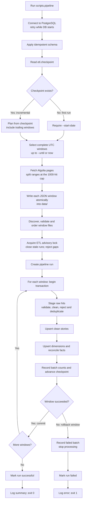
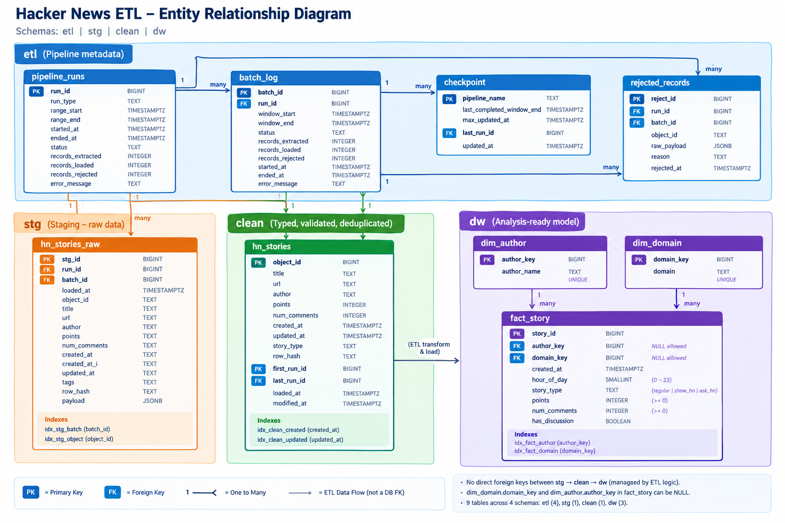

# Hacker News ETL Pipeline

This project builds an end-to-end ETL pipeline for Hacker News stories from the Algolia API. It follows a layered data architecture: raw staging, validated/clean data, and an analytics-ready warehouse model. The full workflow is implemented both as SQL-first steps and as a Python-driven operational pipeline.

## Project summary

- Source: Algolia Hacker News search endpoint, filtered to story records
- Dedup key: objectID, stored as BIGINT in the clean layer
- Slice used for the demo: 3 complete UTC days, with 6-hour windows (12 batches total)
- Operational DB: PostgreSQL 16 in Docker
- ETL layers:
  - stg: raw JSON payloads and raw fields, append-only
  - clean: typed, cleaned and deduplicated business records
  - dw: fact and dimension tables for analysis
  - etl: pipeline metadata, checkpoints, rejects, run and batch logs
- Critical design choice: the pipeline is incremental-aware and idempotent, with checkpoints and trailing re-pulls to cover shifting story metadata such as updated_at and score/comment counts

## Design decisions captured from project state

The project decisions are the foundation for the current implementation:

- Data source is the Hacker News story API at `https://hn.algolia.com/api/v1/search_by_date?tags=story`.
- The working time window is UTC, with half-open intervals: `[start, end)`.
- Download windows are 6 hours, which gives 12 batches for a 3-day slice.
- Files are saved as raw JSON under `data/` with a naming convention like `hn_YYYYMMDDTHHMMZ_YYYYMMDDTHHMMZ.json`.
- The staging layer keeps the original payload and selectively strips `_highlightResult`, while raw source files remain untouched.
- Checkpoint commits occur in the same transaction as the data load for a batch.
- SQL and Python share the same logic boundaries: SQL handles schema creation, staging load, cleaning, transformation, and validation; Python handles API fetching, file orchestration, metadata, retries, and the operational pipeline.
- The schema is versioned and safe to re-run: create scripts are idempotent and migration logic removes obsolete columns.
- Re-running the same stage should not create duplicate reject rows or duplicate clean records; the final design is idempotent by design.
- Trailing re-pull is included because Hacker News updates can continue after a story is first observed.
- Validation is intentionally state-agnostic and compares layers to each other instead of hardcoding a single count, so it works after a fresh load, a dirty fixture run, and an idempotent re-run.

## Repository layout

- `sql/01_create_schema_tables.sql` — schema and tables for `etl`, `stg`, `clean`, and `dw`
- `sql/02_load_staging.sql` — append raw JSON rows from local files into staging
- `sql/03_clean.sql` — validate, clean, hash, and deduplicate records into `clean.hn_stories`
- `sql/03_dirty_fixture.sql` — generates a dirty demo batch to test rejection and dedup logic
- `sql/04_transform.sql` — build dimensions and fact table; update metadata and checkpoint
- `sql/05_validate.sql` — read-only validation and analysis of the final model
- `scripts/client.py` — HTTP client with retry logic and safe error handling
- `scripts/downloader.py` — downloads Algolia windows into the local `data/` folder
- `scripts/etl.py` — Python ETL orchestration and data loading logic
- `scripts/transform.py` — Python cleaning/normalization logic used by the Python pipeline
- `scripts/pipeline.py` — full operational pipeline entrypoint
- `scripts/logger.py` — centralized logging configuration
- `main.py` — convenience entry point and description of the high-level workflow
- `docker-compose.yml` — PostgreSQL 16 container setup

## Pure SQL run path

This is the simplest and most explicit pipeline flow, intended to demonstrate the database logic end-to-end.

Start the database:

```bash
docker compose down -v
docker compose up -d
```

Then run the SQL steps in order:

```bash
docker compose exec db sh -c 'psql -U $POSTGRES_USER -d $POSTGRES_DB -v ON_ERROR_STOP=1 -f /sql/01_create_schema_tables.sql'
docker compose exec db sh -c 'psql -U $POSTGRES_USER -d $POSTGRES_DB -v ON_ERROR_STOP=1 -f /sql/02_load_staging.sql'
docker compose exec db sh -c 'psql -U $POSTGRES_USER -d $POSTGRES_DB -v ON_ERROR_STOP=1 -f /sql/03_clean.sql'
docker compose exec db sh -c 'psql -U $POSTGRES_USER -d $POSTGRES_DB -v ON_ERROR_STOP=1 -f /sql/04_transform.sql'
```

To demonstrate dirty-data handling and idempotent recovery:

```bash
docker compose exec db sh -c 'psql -U $POSTGRES_USER -d $POSTGRES_DB -v ON_ERROR_STOP=1 -f /sql/03_dirty_fixture.sql'
docker compose exec db sh -c 'psql -U $POSTGRES_USER -d $POSTGRES_DB -v ON_ERROR_STOP=1 -f /sql/03_clean.sql'
docker compose exec db sh -c 'psql -U $POSTGRES_USER -d $POSTGRES_DB -v ON_ERROR_STOP=1 -f /sql/04_transform.sql'
docker compose exec db sh -c 'psql -U $POSTGRES_USER -d $POSTGRES_DB -v ON_ERROR_STOP=1 -f /sql/04_transform.sql'
```

The final validation step is read-only and safe to run at any time after the load:

```bash
docker compose exec db sh -c 'psql -U $POSTGRES_USER -d $POSTGRES_DB -v ON_ERROR_STOP=1 -f /sql/05_validate.sql'
```

To save the validation output to a file:

```bash
mkdir -p evidence
docker compose exec db sh -c 'psql -U $POSTGRES_USER -d $POSTGRES_DB -v ON_ERROR_STOP=1 -f /sql/05_validate.sql' > evidence/05_validate.txt
```

## Python-driven run path

The Python path is the operational ETL flow. It is designed for a live or repeatable run that downloads new windows, applies the checkpoint logic, and then loads the transformed results into the same PostgreSQL database.

Typical usage:

```bash
uv run python -m scripts.pipeline --start-date 2026-10-01 --until 2026-10-04
```

Incremental runs use the checkpoint automatically:

```bash
uv run python -m scripts.pipeline
uv run python -m scripts.pipeline --until 2026-10-05
```

The same workflow is also exposed at a lower level:

```bash
uv run python -m scripts.downloader --start-date 2026-10-01 --days 3
uv run python -m scripts.etl --mode auto
```

The Python entrypoints are responsible for:

- retrying HTTP calls and rate-limit-safe requests
- window planning for a date range, checkpoint-aware incremental loads, and trailing re-pulls
- parsing raw JSON and validating counts against `meta.nbHits`, `hits_retrieved`, and the actual array length
- cleaning through `scripts.transform`
- persisting metadata in `etl.pipeline_runs`, `etl.batch_log`, and `etl.checkpoint`
- using one transaction per window so the batch metadata and data changes commit or roll back together

### Python run flow

The recommended entrypoint is `scripts.pipeline`. It coordinates database setup, API downloads, and ETL loading in one invocation:



#### What happens at each stage

1. **Connect and prepare the database.** The pipeline connects using `HN_ETL_DSN` or the PostgreSQL settings from the environment (compose defaults otherwise). It retries while PostgreSQL starts, applies the idempotent `01_create_schema_tables.sql`, and reads the `hn_stories` checkpoint.
2. **Plan and download windows.** On the first run, pass `--start-date`; subsequent runs start from the checkpoint and re-pull the configured trailing windows (2 by default). The planner uses complete UTC windows only, bounded by `--until` or the current time. Existing files are skipped unless `--force-download` is supplied. Algolia requests are retried for transient failures, and large ranges are recursively split to avoid the API's 1000-hit result cap. Each completed window is written via a temporary file and renamed atomically.
3. **Choose files for the ETL run.** The loader acquires a PostgreSQL advisory lock so two ETL loads cannot run concurrently. It marks runs left `running` by an interrupted process as failed, discovers the JSON windows, validates each file's metadata/counts against its filename and hit array, plans full vs incremental processing from the checkpoint, and refuses gaps or overlapping windows.
4. **Process each window in one transaction.** Python parses each hit, stores the staging row and original payload, records rejects, cleans and deduplicates valid stories, and upserts changed records into `clean.hn_stories`. It then adds missing author/domain dimension members and reconciles fact rows from the current clean values. The batch result and checkpoint are written in the same transaction as these changes.
5. **Finish or recover.** A successful window commits and processing continues. If a window fails, its transaction rolls back; the pipeline records a failed batch separately, stops rather than skipping ahead, and marks the run failed. Previously committed windows remain available, with their checkpoint progress intact. The next invocation can retry from that checkpoint. Successful completion marks the run successful and logs extracted, loaded, and rejected counts.

Here, **loaded** means fact rows inserted or changed by the run; a repeated, unchanged story does not count as loaded. **Rejected** counts raw hits that failed validation and were recorded with their reason in `etl.rejected_records`. Logging goes to the console and to `logs/pipeline.log`.

#### Useful command options

- `--start-date YYYY-MM-DD` — starting date for the initial load; ignored with a warning when a checkpoint already exists.
- `--until YYYY-MM-DD` — exclusive upper date boundary; only windows ending on or before it are processed.
- `--window-hours N` — window size (default `6`; must evenly divide 24 and match the existing window alignment).
- `--trailing-windows N` — number of previously completed windows to re-download and reprocess (default `2`).
- `--force-download` — replace matching existing window files with fresh API results.
- `--skip-download` — load files already in `data/` without calling Algolia.
- `--data-dir PATH` and `--dsn CONNECTION_STRING` — override the defaults for the JSON folder and database connection.

For example, to download the first three complete days, then later process incremental changes:

```bash
uv run python -m scripts.pipeline --start-date 2026-10-01 --until 2026-10-04
uv run python -m scripts.pipeline
```

The lower-level commands are useful when the stages need to be run separately: `scripts.downloader` only fetches files, while `scripts.etl` loads existing files into a database whose schema has already been created. The `scripts.pipeline` command is preferred for regular use because it coordinates both stages and applies the schema first.

## Data model and transformation rules

### Entity-relationship diagram

The diagram shows the database foreign-key relationships declared in the schema. The staging-to-clean and clean-to-fact transitions are ETL lineage rather than foreign keys; they are noted below the diagram.



**ETL lineage (not enforced by foreign keys):** `stg.hn_stories_raw` records are validated and deduplicated into `clean.hn_stories` using `object_id`; `dw.fact_story.story_id` is populated from `clean.hn_stories.object_id`. The schema intentionally does not declare FKs for these layer-to-layer relationships. A NULL author or domain is allowed in `dw.fact_story`.

**Notation:** `PK` = primary key, `FK` = foreign key, `UK` = unique key. `o|` on the dimension side indicates an optional dimension reference from a fact row.

### Staging (`stg.hn_stories_raw`)

- append-only raw store of every downloaded hit
- keeps `payload` as the original JSON minus `_highlightResult`
- stores `tags` as a JSON text snapshot and keeps row hash as `NULL` until cleaning
- each file becomes one batch and one transaction commit

### Cleaning (`clean.hn_stories`)

- typed conversion for `object_id`, `points`, `num_comments`, `created_at`, and `updated_at`
- rejects invalid rows into `etl.rejected_records`
- trims whitespace and HTML-decodes titles
- derives `story_type` from `_tags` with precedence:
  - `show_hn`
  - `ask_hn`
  - otherwise `regular`
- computes `row_hash` over cleaned business fields for change detection
- deduplicates within the run using `DISTINCT ON (object_id)` and keeps the latest `updated_at`
- upsert logic only updates if the row content truly changes and the incoming record is not older

### Warehouse (`dw.fact_story`, `dw.dim_author`, `dw.dim_domain`)

- dimensions are insert-only (`ON CONFLICT DO NOTHING`)
- fact table is reconciled against the full clean layer
- `domain_key` is computed from URL host with `etl.extract_domain()`
- `hour_of_day` is UTC hour of `created_at`
- `has_discussion` is `num_comments > 0`
- metadata and checkpoint rows are committed in the same transaction as the transform

## Validation logic (`05_validate.sql`)

The final validation step is intentionally comprehensive and read-only. It checks several dimensions of the pipeline and prints the result in sections:

1. Record-count consistency across layers and runs
2. Duplicate detection and dimension integrity
3. Missing-value and null checks
4. Successful-load metadata and run state validation
5. Analysis summaries by domain, hour, story type, and author

Key validation rules include:

- every run's `records_extracted` equals the number of staged rows
- every run's `records_rejected` equals the number of reject rows
- `loaded + rejected <= extracted`
- clean rows and fact rows match in count
- no duplicate `object_id` or `story_id`
- required columns are never null
- domain_key must be null exactly when the URL has no domain
- the latest run must have succeeded and no batch should remain `running`

The validation script also excludes fixture rows (`story_id >= 99000000`) from analysis queries so the analysis remains on the real dataset.

## Operational notes

- Staging is deliberately append-only. Re-loading the same JSON file creates a new run and new rows; clean and fact layers handle deduplication.
- The pipeline supports incremental refreshes with a trailing re-pull window. This matters because story metadata continues to change after initial retrieval.
- A failed batch stops the run, preserving earlier committed work while leaving the failing run marked as failed.
- The dirty demo fixture intentionally creates invalid rows, duplicates, and a trailing incremental window to prove the rejection and idempotency logic.

## Final status

The implementation is complete for the full ETL lifecycle:

- schema is created idempotently
- raw staging loads from JSON files
- clean/dedup validation occurs
- dimensions and fact table are transformed
- metadata and checkpoints are maintained
- the final validation script confirms state integrity and produces analysis-ready summaries

This project is now ready for operational use through either the SQL-first demonstration path or the Python-driven pipeline path.
